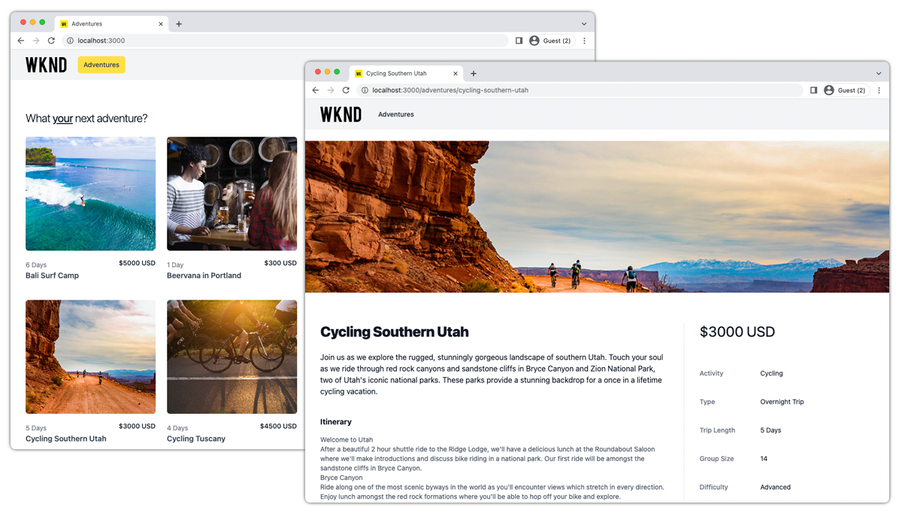

# Next.js App - WKND Adventures

An example Next.js application that highlights Adobe Experience Manager's GraphQL APIs and the [AEM Headless Client for JavaScript](https://github.com/adobe/aem-headless-client-js).

This application is loosely based on the [Adobe Next.js Template](https://github.com/adobe/aem-nextjs-template/) but has been trimmed to focus on the AEM Headless GraphQL use case.



## How to use

Open the [App Builder demo landing page](https://102588-424goldmagpie.adobeio-static.net/), enter your AEM Author URL and temporary access token, and select **Save settings**. The proxy URL and GraphQL namespace (`wknd-shared`) are read-only. Open either app card in the same tab.

The app fetches content in the browser using only the saved session settings. No AEM environment files or repository variables are required. Without saved settings, it displays a configuration error instead of making AEM requests.

To build locally:

```shell
cd next-js
npm ci
npm run export
```


## System Requirements

 AEM as a Cloud Service | AEM 6.5 | Sample Content | Node   | npm | 
------------------------|---------|--------------------|---------|-----|
Continual               | 6.5.13+ |  [WKND Shared 2.0+](https://github.com/adobe/aem-guides-wknd-shared/releases/latest) or [WKND Site 2.0+](https://github.com/adobe/aem-guides-wknd/releases/latest)| 10+  | 6+

## Notes

Adventure detail pages show a **Related adventures** section for `AdventureModel` entries in the `adventure-by-slug` response's `_references`, linking to each adventure and displaying its price when available. Each related card makes an additional `adventure-by-slug` request to load its `primaryImage._path`, served from AEM Publish. Cards remain usable while images load; missing images and request errors are shown on the card. No AEM query changes are required. The section is hidden when no other adventures with slugs are referenced.

## Adobe App Builder hosting

This folder now lives alongside `react-app` in the App Builder project.
From the parent folder, run `npm run build:wknd` to build both apps, or
`npm run deploy:wknd` to build and deploy their web assets together.
The build exports Next.js with `NEXT_PUBLIC_BASE_PATH=/next-js` and copies
`out/` to `dist/application/web-prod/next-js/` at the project root.
No Next.js server is required; content is fetched in the browser.

The shared session module is maintained at `../react-app/src/sessionConfig.js`
and re-exported by `lib/sessionConfig.js`, so both apps use the same proxy,
token transport, and settings scope. Existing direct-connection sessions adopt
the demo proxy without requiring tokens to be re-entered.
On App Builder the proxy URL follows the current workspace origin; localhost
and other previews continue using the existing hosted demo proxy.

For a local combined preview, serve `../dist/application/web-prod`
after a combined build. Separate development-server ports do not share settings.

GraphQL requests always go through the saved demo proxy. Tokens are sent as Bearer headers, not URL parameters. The proxy must allow CORS requests from the demo origin and forward `Authorization` to AEM.

## Documentation

* [AEM Headless Tutorials](https://experienceleague.adobe.com/docs/experience-manager-learn/getting-started-with-aem-headless/overview.html)
* [AEM Headless Developer Journey](https://experienceleague.adobe.com/docs/experience-manager-cloud-service/headless-journey/developer/overview.html)
* [AEM Headless Client for JavaScript](https://github.com/adobe/aem-headless-client-js)
