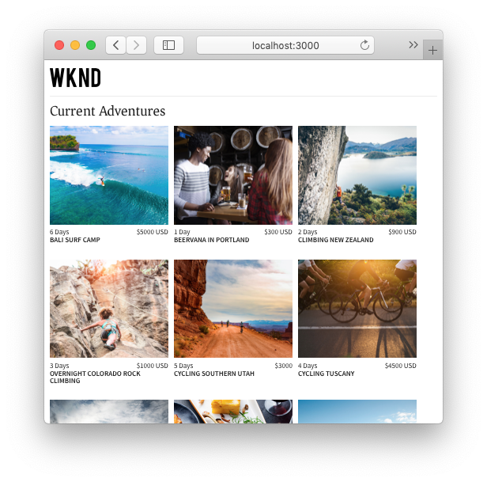

# React App - WKND Adventures

An example React application that highlights Adobe Experience Manager's GraphQL APIs and the [AEM Headless Client for JavaScript](https://github.com/adobe/aem-headless-client-js).

This project was bootstrapped with [Create React App](https://github.com/facebook/create-react-app).



## Tutorial

A corresponding [tutorial](https://experienceleague.adobe.com/docs/experience-manager-learn/getting-started-with-aem-headless/graphql/multi-step/setup.html) is available where you can learn how to setup and run the application to query data from an AEM environment using GraphQL.

## How to use

1. On the target AEM environment install the `aem-guides-wknd-shared.ui.content-x.x.x.zip` from the [latest release of the WKND Shared Content](https://github.com/adobe/aem-guides-wknd-shared/releases/latest) using [Package Manager](http://localhost:4502/crx/packmgr/index.jsp).
1. Open the [demo landing page](https://102588-424goldmagpie.adobeio-static.net/index.html) on the hosted site. Its source is [landing/index.html](../landing/index.html).
1. Enter your AEM Author URL and temporary access token, then select **Save settings**. The GraphQL namespace (`wknd-shared`) is read-only.
1. Open the React app card in the same tab.

To build the app locally, install [Node.js](https://nodejs.org/en/) and [npm](https://www.npmjs.com/), then run:

    ```shell
    $ cd "/Users/jihuang/Desktop/work/app builder/react-app"
    $ npm ci
    $ npm run build
    ```

> On local environments it may be easier to simply install the full [WKND Site 2.0+](https://github.com/adobe/aem-guides-wknd/releases/latest) which will include the WKND Shared content and additional CORS configurations.

## System Requirements

 AEM as a Cloud Service | AEM 6.5 | Sample Content | Node   | npm | 
------------------------|---------|--------------------|---------|-----|
Continual               | 6.5.13+ |  [WKND Shared 2.0+](https://github.com/adobe/aem-guides-wknd-shared/releases/latest) or [WKND Site 2.0+](https://github.com/adobe/aem-guides-wknd/releases/latest)| 10+  | 6+

## Notes

Adventure detail pages show a **Related adventures** section for `AdventureModel` entries in the `adventure-by-slug` response's `_references`, linking to each adventure and displaying its price when available. Each related card makes an additional `adventure-by-slug` request to load its `primaryImage._path`, served from AEM Publish. Cards remain usable while images load; missing images and request errors are shown on the card. No AEM query changes are required. The section is hidden when no other adventures with slugs are referenced.

Run the related-adventure UI, query, and session settings tests using the React app's existing test runner (from `react-app`):

```shell
CI=true npm test -- --watch=false --runInBand \
  --testPathPattern='AdventureDetail.test.js|usePersistedQueries.test.js|sessionConfig'
```

### Browser Session Settings

All AEM connection settings come from the browser's `sessionStorage`, not environment files or repository variables. Without saved settings, the app shows a configuration error rather than making AEM requests. Clearing settings requires configuring the connection again.

For a local preview, serve `../dist/application/web-prod` after running `npm run build:app-builder`. This keeps the landing page, shared settings script, and both apps on the same origin, with paths matching the build. Opening standalone development servers on separate ports does not share session settings.

### Proxied AEM API Requests

Both React and Next.js send GraphQL requests through
`/api/v1/web/aem/aem-cors-proxy` on their current App Builder origin.
Localhost and external previews continue using the hosted demo proxy at
`https://102588-424goldmagpie.adobeio-static.net/api/v1/web/aem/aem-cors-proxy`.
The selected AEM host is passed as `aemHost`; the temporary token is sent only in
the `Authorization: Bearer` header. Requests omit cookies. Existing settings
without a proxy field automatically adopt this proxy. Images remain direct
requests to AEM Publish.

### Test hosting on Adobe App Builder

Install the Adobe I/O CLI (`aio`) and use an App Builder-enabled Developer Console project.
From the App Builder project root, run:

```shell
npm --prefix react-app ci
npm --prefix next-js ci
aio login
aio app use /path/to/workspace-config.json --no-input
aio where
npm run deploy:wknd
```

Use a dedicated test workspace where possible. Deployment replaces that workspace's
hosted web assets; confirm the target shown by `aio where` before deploying.
The deployment script uploads only web assets, without deploying actions,
publishing extensions, or updating log forwarding.

The custom `build-static` hook preserves the Create React App build instead of
rebundling it with Parcel. It generates `dist/application/web-prod` at the project root with the
landing page, shared session settings script, React at `/react-app/`, and the
static Next.js export at `/next-js/`. Run `npm run build:app-builder` to build
both apps without deploying; install dependencies in both sibling folders first.
The landing page source is `../landing/index.html`. The root build script and
App Builder configuration own the combined site; this package's
`build:app-builder` and `deploy:app-builder` commands delegate to the root.
The normal `npm run build`
still builds React only. No original repository files are required.

Open `https://<namespace>.adobeio-static.net/`, save your AEM Author URL and
temporary access token, then open the React card in the same tab. Settings saved
on GitHub Pages are not shared with this origin. Both apps share the proxy's
origin in this deployment. The app already uses hash-based routes, so detail
page reloads do not require server-side URL rewrites.

Workspace credentials (`.aio`, `.env`, and temporary AWS credentials) are ignored
by Git. Never add an AEM token to build configuration or source files.

### CORS - Cross Origin Resource Sharing

The browser connects to the demo proxy, which requests AEM server-side.
The deployed apps and proxy share an origin, so GraphQL needs no cross-origin
permission there. For localhost or another hosting origin, the proxy must allow
that origin and the Authorization header. Images continue to be served directly
from the corresponding AEM Publish host.

## Documentation

* [AEM Headless Tutorials](https://experienceleague.adobe.com/docs/experience-manager-learn/getting-started-with-aem-headless/overview.html)
* [AEM Headless Developer Journey](https://experienceleague.adobe.com/docs/experience-manager-cloud-service/headless-journey/developer/overview.html)
* [AEM Headless Client for JavaScript](https://github.com/adobe/aem-headless-client-js)


